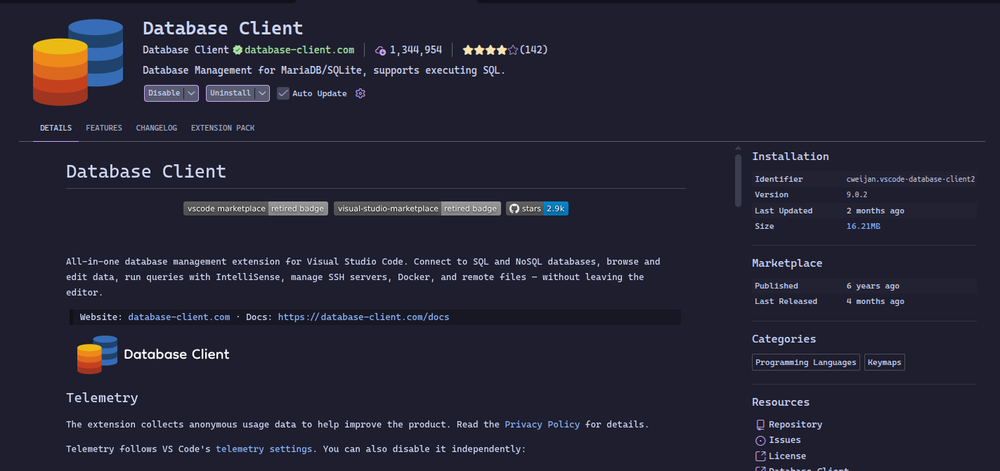
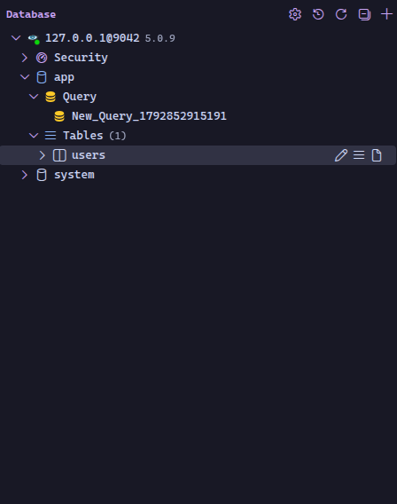

#### Trabalho basico de bancos NoSql

Cassandras 

#### Comandos para ativar o Keyspace e criar a tabela:
isso configura no global do cassandra o keyspace e a tabela para o projeto.


```bash
docker compose exec cassandra cqlsh -u root -p root -e "DESCRIBE KEYSPACE app;"
```

### Query para criar o keyspace e a tabela:

extenssão a ser usada: ou usar o dbeaver-ce



credenciaiais: user: root, password: root, database: app, port: 9042 host: padrão do local que vier



so clicar em query e rodar o comando sql abaixo para criar a tabela e inserir um registro de teste:

```bash
CREATE TABLE IF NOT EXISTS app.users (
    id uuid PRIMARY KEY,
    name text,
    email text,
    created_at timestamp
);

INSERT INTO app.users (id, name, email, created_at) VALUES (uuid(), 'Hermeson', 'hermeson@email.com', toTimestamp(now()));

SELECT * FROM app.users;
```


### Comando docker (ubuntu) para sumir com os container volumens e etc:

```bash
[ -n "$(docker ps -q)" ] && docker stop $(docker ps -q) || echo "Nenhum contêiner ativo para parar."; \
[ -n "$(docker ps -a -q)" ] && docker rm $(docker ps -a -q) || echo "Nenhum contêiner para remover."; \
[ -n "$(docker images -a -q)" ] && docker rmi $(docker images -a -q) -f || echo "Nenhuma imagem para remover."; \
docker image prune -f
````